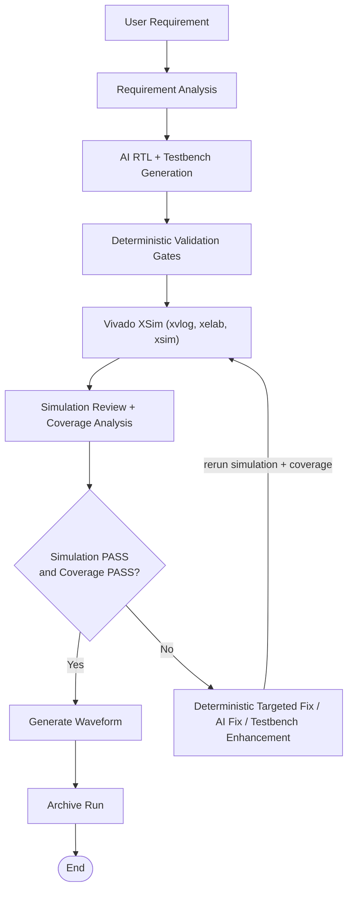

# AI_VIVADO_PROJECT

An AI-in-the-loop Verilog RTL generator and self-checking verification
pipeline. A local LLM (via Ollama) produces synthesizable Verilog-2001 RTL
plus a self-checking testbench; Vivado XSim compiles and simulates it; a
deterministic coverage engine plus AI fix agents close the loop until the
design passes functional simulation AND coverage.

> Status: **Phase 1 complete** (validation + GitHub-prep). Phase 2 (logic
> synthesis) is NOT started. See [VALIDATION_STATUS.md](VALIDATION_STATUS.md)
> and [PHASE1_VALIDATION_AUDIT.md](PHASE1_VALIDATION_AUDIT.md).

---

## 1. Project overview

The pipeline automates the classic design flow for small RTL blocks:

```
user request → requirement analysis → AI RTL+TB generation
   → Vivado compile/elaborate/simulate → review → coverage gate
   → (deterministic targeted fix | AI fix | AI TB enhancement) → loop → PASS
```

Every stage is a standalone Python module under `app/`, orchestrated by
`app/main.py`. `main.py` saves every finished run (PASS or FAIL) under
`runs/<timestamp>/` for reproducibility.

### Features

- Plain-English request → synthesizable **Verilog-2001 RTL** + a
  **self-checking testbench**, generated by a local LLM (Ollama).
- **Deterministic generation gates**: request-relevance, bit-width
  fidelity, testbench self-consistency, and a fast `xvlog` compile gate.
- **Vivado XSim** compile / elaborate / simulate with per-step logs, a
  per-step timeout, and a process-tree kill.
- **Evidence-based coverage engine** across COMBINATIONAL, SEQUENTIAL,
  MEMORY, PROTOCOL and COMPLEX categories.
- **Self-healing loop**: deterministic targeted fix, AI fix agent, and
  testbench enhancement.
- **Waveform capture** (`waveform.wdb` + PNG) and a one-shot Vivado
  project on PASS.
- **Workspace isolation** per run plus timestamped run archives
  (`runs/`) for reproducibility.
- A **timeout-bounded LLM client** and a **dependency-free regression
  harness** (no Ollama, no Vivado).

### Pipeline flow



The loop continues until simulation **PASS** and coverage **PASS**, subject to
the configured limits (`max_attempts` and `max_pipeline_minutes` in
`config.json`).

## 2. Problem statement

Manually writing a testbench, running simulation, and iterating on a
failing design is slow. This project explores whether a small local LLM
(`qwen2.5-coder`) can:

- generate synthesizable Verilog-2001 RTL from a plain-English request;
- generate a *self-checking* testbench that prints deterministic
  `SIMULATION SUCCESSFUL` / `SIMULATION FAILED` and explicit assertions;
- self-heal through a deterministic targeted fix and an AI fix agent;
- report coverage honestly rather than blindly declaring success.

Phase 1 focused on validating the *mechanisms* and documenting where the
AI stages remain unreliable.

## 3. Architecture

| Module | Role |
|--------|------|
| `app/main.py` | Orchestrator, CLI, attempt loop, run archive |
| `app/workspace.py` | Design-id creation and workspace management |
| `app/analyze_requirement.py` | Classify request → category + verification plan |
| `app/generate_verilog.py` | LLM RTL+TB generation + deterministic gates (relevance, width fidelity, TB self-consistency, compile gate) |
| `app/run_simulation.py` | Vivado xvlog/xelab/xsim (per-step logs, timeout, tree-kill) |
| `app/review_simulation.py` | Parse sim log → STATUS / FAILURE_TYPE |
| `app/analyze_testbench.py` | Testbench analysis + coverage status |
| `app/coverage_engine.py` | Evidence-based coverage (COMBINATIONAL / SEQUENTIAL / MEMORY / PROTOCOL / COMPLEX) |
| `app/complete_coverage.py` | Deterministic combinational coverage completion |
| `app/targeted_fix.py` | Deterministic single-expected-value repair (TB-side) |
| `app/fix_verilog.py` | LLM-based fix agent with change-size validation |
| `app/enhance_testbench.py` | LLM-based testbench enhancement for missing coverage |
| `app/verilog_autofix.py` | Deterministic undeclared-signal + `$coverage` patches |
| `app/generate_waveform.py` | Vivado `waveform.wdb` + project creation |
| `app/export_waveform_png.py` | Waveform → PNG rendering |
| `app/llm_client.py` | Shared timeout-bounded Ollama client |
| `app/vivado_config.py` | Portable VIVADO_BIN resolution |
| `app/regression.py` | Deterministic regression harness (no LLM/Vivado) |

## 4. End-to-end workflow

1. Parse the user request (or `--workspace` for a fixture).
2. `analyze_requirement.py` writes `requirement_analysis.json`.
3. `generate_verilog.py` asks the LLM for design + testbench + `TOP_MODULE`,
   then runs deterministic gates:
   - **request-relevance check** (rejects example-copy drift);
   - **width-fidelity check** (rejects wrong-bit-width copies);
   - **testbench self-consistency check** (rejects literal-vs-message contradictions);
   - **compile gate** (fast `xvlog` + undeclared-signal auto-patch).
4. `run_simulation.py` compiles, elaborates and simulates in Vivado XSim.
5. `review_simulation.py` classifies the outcome.
6. `analyze_testbench.py` + `coverage_engine.py` compute coverage.
7. Loop until **simulation PASS and coverage PASS** (bounded by
   `max_attempts` and `max_pipeline_minutes`).
8. On PASS: waveform artifacts are generated and the run is archived.

## 5. AI components

- **LLM generation** (`ollama_generate_model`, default `qwen2.5-coder:7b`)
  — RTL + testbench.
- **Fix agent** (`ollama_fix_model`, default `qwen2.5-coder:3b`) — repairs
  compile/functional failures, validated by change-size thresholds.
- **Enhance agent** (`ollama_fix_model`) — adds missing coverage scenarios.
- Shared `llm_client.py` enforces `llm_timeout_seconds` on every call so a
  hung model cannot stall the pipeline.

## 6. Ollama / model setup

```bash
# install Ollama, then pull the models
ollama pull qwen2.5-coder:7b
ollama pull qwen2.5-coder:3b
```

Model names are configurable via `ollama_model`, `ollama_generate_model`,
`ollama_fix_model` in `config.json`.

## 7. Vivado / XSim integration

Pipeline invokes `xvlog.bat`, `xelab.bat`, `xsim.bat` directly (TCL
scripts in `scripts/` are legacy and unused). Per-step logs are written to
`<workspace>/logs/`. A 60-second timeout plus a process-tree kill protects
against runaway simulations.

**Portability:** the committed `config.json` carries an empty
`vivado_path`. The bin directory is resolved at runtime by
`app/vivado_config.py` in this order:

1. `VIVADO_BIN` environment variable (recommended);
2. `vivado_path` in `config.json` (local override);
3. `xvlog.bat` on `PATH`;
4. known default install roots.

Requires Vivado **2018.2 or later** on Windows (verified against 2018.2).

## 8. Requirement analysis

`analyze_requirement.py` classifies the request (combinational, sequential,
memory, etc.) and emits a verification strategy into
`requirement_analysis.json`. In `--skip-generate` mode analysis is skipped;
provide a `requirement_analysis.json` in the workspace if category-aware
coverage completion is required.

## 9. RTL / testbench generation

The generation prompt (`prompts/generate.txt`) requires synthesizable
Verilog-2001, a self-checking testbench with the canonical assertion block,
`COVERAGE_CASE`/`COVERAGE_HIT` markers, and exactly three output sections
(design, testbench, `TOP_MODULE=<name>`). Examples are formats-only and
example-module reuse is explicitly forbidden (see F1 under Known
limitations).

## 10. Simulation review

`review_simulation.py` scans `simulation.log` for
`SIMULATION SUCCESSFUL` / `SIMULATION FAILED` and prints structured
`STATUS` / `FAILURE_TYPE` used by `main.py`.

## 11. Deterministic targeted fix

`targeted_fix.py` parses a single functional assertion failure in the log
and — when failure type, expected value, and actual value are all present —
rewrites only the *testbench* expected literal (deterministic, no LLM).
It declines when multiple assertions fail or the failure is not functional.
The RTL is never modified by this stage.

## 12. AI fix path

When deterministic repair cannot help (compile errors, multi-failure, …),
`fix_verilog.py` asks the fix model to produce a corrected design or
testbench. The change is validated against strict/relaxed percentage
thresholds (`fix_change_strict_rtl_pct`, …) before being accepted.

## 13. Coverage engine

`coverage_engine.py` scores coverage from *simulation evidence* by category:

- **COMBINATIONAL** — exhaustive input combinations when `≤8` inputs;
- **SEQUENTIAL** — reset-asserted, enable-active/inactive, state
  transitions, boundary wrap;
- **MEMORY / PROTOCOL / COMPLEX** — respective feature checks.

Coverage must reach the thresholds in `config.json` (default 100%).
Known parser limitations are listed under Known limitations (F3/F4).

## 14. Testbench enhancement

For missing coverage, `complete_coverage.py` deterministically appends the
missing combinational stimulus. For everything else,
`enhance_testbench.py` invokes the enhance model to add scenarios; results
are validated for change size and marker presence and the testbench is
restored if the enhanced version fails simulation.

> **F8 (known limitation):** sequential coverage-marker enhancement with
> the 3B model is currently **unreliable** — it can inject checks whose
> assertions fail on resim. The deterministic combinational path is not
> affected.

## 15. Waveform generation

On PASS, `generate_waveform.py` re-runs the sim to capture `waveform.wdb`
and creates a Vivado project; `export_waveform_png.py` renders a signal
image. Signal extraction is partial for some designs (F6).

## 16. Workspace isolation

Every run works inside its own directory (env `AI_WORKSPACE` or
`--workspace`). In `--skip-generate` (developer/fixture) mode an explicit
`--workspace` is **required**; the old global `generated/` fallback is
disabled so runs cannot corrupt each other.

## 17. Archive / run handling

`main.py` copies the finished workspace (RTL, TB, logs, coverage report,
waveform) plus a `summary.json` into `runs/<YYYY-MM-DD_HH-MM-SS_ffffff>/`.
Collision-proofing was added in Phase 1 — archives now carry a microsecond
timestamp and are uniquified if a directory already exists.

## 18. Regression validation

`app/regression.py` is a lightweight deterministic harness (no LLM, no
Vivado) that exercises the classifier, coverage engine, deterministic
targeted fix, and coverage completion. **11/11 checks pass.** See
[REGRESSION.md](REGRESSION.md) for exactly what it does — it is a logic
regression, NOT a substitute for simulation on real hardware tools.

## 19. Installation

Requirements: Windows, Python 3.10+ (validated on 3.12), Ollama, Vivado.

```powershell
# 1) virtual environment + deps
py -3.12 -m venv .venv
.\.venv\Scripts\python.exe -m pip install -r requirements.txt

# 2) Ollama models
ollama pull qwen2.5-coder:7b
ollama pull qwen2.5-coder:3b

# 3) point the pipeline at Vivado
$env:VIVADO_BIN = "C:\Xilinx\Vivado\2018.2\bin"   # your install
```

## 20. Configuration

`config.json` (committed) is portable:

```jsonc
{
  "ollama_model": "qwen2.5-coder:7b",
  "ollama_generate_model": "qwen2.5-coder:7b",
  "ollama_fix_model": "qwen2.5-coder:3b",
  "llm_timeout_seconds": 600,
  "max_attempts": 6,
  "max_pipeline_minutes": 10,
  "vivado_path": "",          // empty => use VIVADO_BIN / PATH / default roots
  "max_fix_retries": 2,
  "fix_change_strict_rtl_pct": 20,
  "fix_change_strict_tb_pct": 30,
  "fix_change_relaxed_rtl_pct": 50,
  "fix_change_relaxed_tb_pct": 60,
  "coverage": { "exhaustive_input_limit": 8, "max_coverage_improve_attempts": 2,
                "thresholds": { "COMBINATIONAL": 100, "SEQUENTIAL": 100,
                                "MEMORY": 100, "PROTOCOL": 100, "COMPLEX": 100 } }
}
```

JSON does not support comments — the `vivado_path` comment above is
documentation only. The machine-specific Vivado install is **not** in the
committed file.

## 21. Example commands

```powershell
# Full AI pipeline (generation → sim → coverage → archive)
.\.venv\Scripts\python.exe app\main.py "design a 4-bit counter with enable and synchronous reset"

# Deterministic fixture run (skip LLM generation).  The workspace must
# already contain design.v, tb.v and top_module.txt.  Pass it as an
# ABSOLUTE path -- a relative --workspace is re-resolved against the
# workspace directory by the Vivado steps and will not find the files.
.\.venv\Scripts\python.exe app\main.py "design a half adder" `
  --skip-generate --workspace "$PWD\examples\half_adder"

# Deterministic regression harness (no Ollama, no Vivado)
.\.venv\Scripts\python.exe app\regression.py
```

### Example workflow and expected output

The shipped `examples/half_adder` workspace exercises the whole
deterministic path (Vivado required, **no LLM**). A successful run looks
like this (real output, trimmed):

```text
# Compile Design / Compile Testbench / Elaborate / Run Simulation ...
SIMULATION SUCCESSFUL
Simulation result: SUCCESS
...
Actual Coverage      : 100.00%
Required Coverage    : 100%
Coverage Status      : PASS

============================================================
FINAL STATUS: PASS
DESIGN VERIFIED SUCCESSFULLY
SIMULATION     : PASS
COVERAGE       : PASS
============================================================
Run saved to: <repo>\runs\<timestamp>\
```

For a run that needs no external tools at all, the regression harness
prints (actual output):

```text
[1] category classification
  [PASS] combinational classified -> COMBINATIONAL
  [PASS] sequential classified -> SEQUENTIAL
  [PASS] memory classified -> MEMORY
...
============================================================
REGRESSION RESULT: 11/11 passed
============================================================
```

### Understanding the outputs

Each run works in one workspace directory — `output/<design_id>/` in full
AI mode, or the `--workspace` directory. After a run it holds:

| File / dir | Meaning |
|------------|---------|
| `design.v` | Generated (or fixture) synthesizable RTL |
| `tb.v` | Self-checking testbench |
| `top_module.txt` | Testbench top-module name passed to `xelab` |
| `requirement_analysis.json` | Inferred category + verification plan (full-AI mode only) |
| `simulation.log` | Combined Vivado xvlog/xelab/xsim console output |
| `logs/` | Per-step Vivado logs (`compile_design.log`, …) |
| `review_report.txt` | `STATUS` / `FAILURE_TYPE` verdict |
| `verification_report.txt` | Structure + coverage report; the `Coverage Status:` line is the gate |
| `waveform.wdb`, `waveform.png` | Waveform database + rendered image (on PASS) |
| `open_wave.tcl`, `<name>.xpr` | One-shot waveform viewer + Vivado project (on PASS) |

Every finished run is also archived under `runs/<timestamp>/` with a copy
of the workspace (`runs/<timestamp>/workspace/`) and a `summary.json`
(request, design id, final status, attempts, timestamp). Exit codes:
**0 = PASS, 1 = FAIL**.

## 22. Validated designs

Precise — do **not** read more into this than is written:

| Design | AI generation | Functional sim | Coverage |
|--------|---------------|----------------|----------|
| 2-input AND gate | Verified post-F1 | PASS (fixtures) | 100 % (exhaustive) |
| 4-bit counter (en + sync reset) | **Verified post-F1** (correct RTL, sim PASS) | PASS | 100 % fixture; AI TB enhancement hit F8 |
| 8-entry FIFO | Deterministic fixture | PASS | 100 % fixture |
| Traffic-light FSM | Deterministic fixture | PASS | 100 % fixture |
| Half adder (`examples/half_adder`) | — (deterministic fixture) | PASS (reproduced 2026-10-16) | 100 % (exhaustive) |

- *Full AI generation* was re-validated end-to-end only for the **4-bit
  counter** and simple combinational designs. Before the F1 fix the 7B
  model emitted a `full_adder`/mux for counter/FIFO/FSM requests.
- FIFO and FSM were validated through **deterministic fixtures**; their
  full AI-generation path was **not** re-validated after F1.

## 23. Known limitations

- **F1 (fixed):** generation drift — the LLM copied the full-adder/mux
  example despite the request. Mitigated by trimming examples and adding a
  relevance gate; verified on a 4-bit counter.
- **F2 (fixed):** run-archive collisions under concurrency (second-resolution
  dirs). Fixed with microsecond timestamps.
- **F8 (open):** sequential coverage enhancement with the **3B** model is
  unreliable (injects failing assertions). `enhance_testbench.py` restores
  the passing TB and reports `TESTBENCH IMPROVEMENT FAILED`.
- **F3 (open):** coverage classification uses substring matching — `"ram"`
  matches `localparam`/`parameter`, mislabeling sequential designs as
  MEMORY (vacuous PASS).
- **F4 (open):** `to_int` parses decimal-`0/1` values as binary
  (e.g. `count=10` → 2).
- **F5 (open):** generation has no run-away guard; a TB that never calls
  `$finish` can grow `simulation.log` very large before the per-step timeout.
- **F6 (open):** waveform signal export is partial (e.g. FIFO → none).
- **F7 (open):** the deterministic targeted fix rewrites the *testbench*
  to match DUT output on a single mismatch — it cannot know the RTL is wrong.

### Troubleshooting

| Symptom | Cause / fix |
|---------|-------------|
| `xvlog.bat` / `xelab.bat` / `xsim.bat` not found | Vivado bin dir not resolved. Set `$env:VIVADO_BIN` (or `vivado_path` in `config.json`) to `...\Vivado\<version>\bin` and confirm `xvlog.bat` is present there (see §7). |
| `Can not find file: <ws>\<ws>\design.v` (doubled path) | `--workspace` was given as a **relative** path; the Vivado steps run with the workspace as their working directory. Pass an absolute path, e.g. `"$PWD\examples\half_adder"`. |
| `PIPELINE STOPPED: --skip-generate requires an explicit --workspace <dir>` | Deterministic mode needs `--workspace <dir>` containing `design.v`, `tb.v`, `top_module.txt`. |
| Ollama connection refused / `ReadTimeout` | Make sure the Ollama service is running and the models are pulled (`ollama pull …`); raise `llm_timeout_seconds` on slow machines. |
| `STEP: … timed out after 60 seconds` | A testbench that never calls `$finish` (see F5) or a hung tool. Each Vivado step is capped at 60 s. |
| Simulation `PASS` but `Coverage Status: FAIL` | Coverage must reach the configured thresholds (default 100 %). Add the missing stimulus — note sequential AI enhancement is unreliable (F8). |
| `waveform.png` missing / matplotlib import error | Install dependencies: `.\.venv\Scripts\python.exe -m pip install -r requirements.txt`. |
| Coverage note "`requirement_analysis.json` missing" in `--skip-generate` mode | Analysis is skipped in this mode; drop a `requirement_analysis.json` in the workspace if category-aware completion is needed. |

## 24. Phase 1 status

**COMPLETE.** 11/11 validation steps executed; audit in
`PHASE1_VALIDATION_AUDIT.md`. High-severity findings F1 (generation drift)
and F2 (run-archive collision) are fixed and verified; F3–F8 are documented
known limitations. Repository is prepared for GitHub publication pending the
final review in this README's companion status document.

## 25. Phase 2 roadmap

- **Logic synthesis** (Vivado `synth_design` + timing reports) — NOT started.
- Fix F3/F4 (classifier + numeric parser) to remove false coverage PASS.
- Make the 3B enhance agent reliable (F8) or fall back to deterministic
  sequential coverage scenarios.
- Add a simulation run-away guard (F5) and richer waveform export (F6).
- Multi-design FSM/FIFO full-AI-path validation.